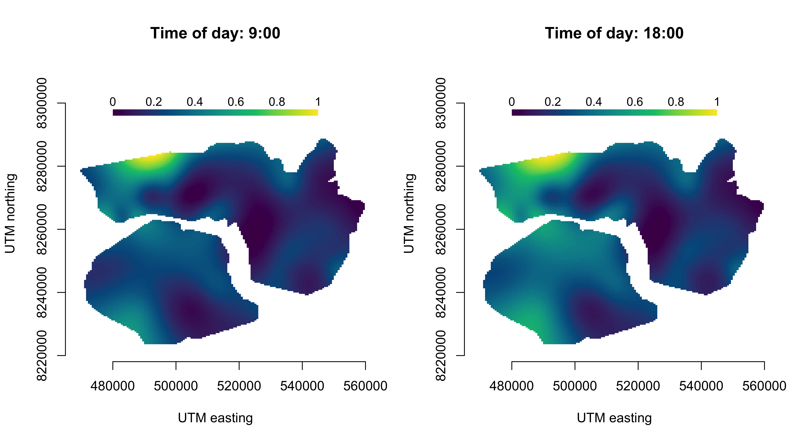

<!-- README.md is generated from README.Rmd. Please edit that file -->

# Tensor-product interactions in Markov-switching models

This repository provides code to reproduce the case studies presented in
the paper [“Tensor-product interactions in Markov-switching
models”](https://arxiv.org/abs/2507.01555).

In the paper I discuss incorporating tensor-product interactions into
Markov-switching models to capture complex temporal and spatial patterns
in animal movement and behaviour data. The approach allows for flexible
modelling of time-varying effects, enabling the analysis of intricate
relationships between multiple covariates over time and space. Efficient
anisotropic smoothness selection is conducted approximately using the
so-called *extended Fellner-Schall method*.

The methodology is illustrated through three applied case studies
analysing

1)  diel variation of an African elephant across the annual cycle,
2)  genotype-specific behavioural rhythms in fruit flies, and
3)  time-varying spatial effects in Arctic muskox movement data.

Code for reproducing all results can be found in the `case_studies`
directory.

## Fitted models and refitting

To save computation time, the scripts load saved model objects from `case_studies/objects` by default (`refit = FALSE`). The fitted models and the grid search fits for the elephant case study, as well as all simulation runs in `simulations/results`, are included in this repository, so `african_elephant.R`, `elephant_grid_search.R` and `simulation.R` run without refitting.

The fitted models for the fruit fly and muskox case studies are too large for GitHub (between 60 MB and 1 GB per file). To run `fruitflies.R` or `muskox.R`, set `refit = TRUE` at the top of the script. The models are then fitted and saved to `case_studies/objects`, after which `refit = FALSE` can be used again. For orientation, refitting took about 10 minutes for the fruit flies and about 4 hours for the muskox (most of which is the space-time model) in our runs; times depend on the machine.

